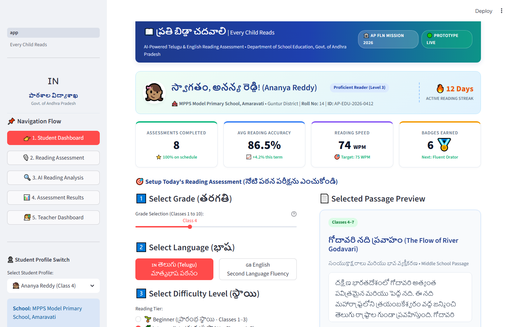
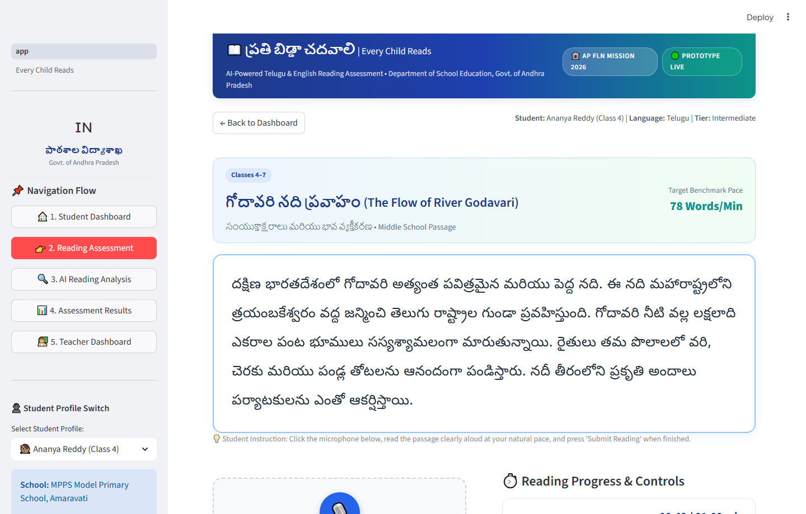

# 📖 Every Child Reads – Telugu AI Assessment (ప్రతి బిడ్డా చదవాలి)
### *AI-Powered Student Reading Assessment Platform Prototype*
**Department of School Education, Government of Andhra Pradesh**

---

## 🏛️ Project Overview

**Every Child Reads (ప్రతి బిడ్డా చదవాలి)** is a state-of-the-art frontend UI prototype developed for the Department of School Education to demonstrate how artificial intelligence can transform foundational literacy and reading assessments across schools in Andhra Pradesh (AP FLN Mission).

The platform provides a child-friendly, interactive reading environment for students reading **Telugu** and **English** passages across **Classes 1 through 10**, evaluates word-level phonetic accuracy and fluency, and delivers actionable, systemic analytics to classroom teachers and headmasters.

> **Note:** This repository is an official, presentation-ready frontend UI prototype. All data is driven by authentic static mock data. No backend, database, speech API, or AI models are required to execute or demonstrate this prototype.

---

## ✨ Features & Available Screens

The application includes five fully functional, interconnected UI screens demonstrating the end-to-end student assessment journey and teacher reporting experience:

### 1. Student Dashboard (`1. Student Dashboard`)
- **Student Profile Hero:** Card featuring the student's avatar, English & Telugu names, student roll number, school name, district, active streak counter (🔥 12 Days), and current proficiency tier.
- **Grade Selector:** Intuitive slider allowing quick selection from **Class 1 to Class 10**.
- **Bilingual Language Switcher:** Interactive toggle between **తెలుగు (Telugu - Mother Tongue)** and **English (Second Language)**.
- **Reading Tier Options:**
  - 🌱 **Beginner (ప్రారంభ స్థాయి):** Classes 1–3 (Sight words & short sentences)
  - 🌿 **Intermediate (మధ్యస్థ స్థాయి):** Classes 4–7 (Compound aksharalu & descriptive passages)
  - 🌳 **Advanced (ఉన్నత స్థాయి):** Classes 8–10 (Technical & academic vocabulary)
- **Live Passage Preview:** Dynamic preview showing passage excerpt, expected duration (~45s), target pace (WPM), and word count.
- **Recent Assessment History:** Historic records and progression milestones.

### 2. Reading Assessment Screen (`2. Reading Assessment`)
- **Child-Friendly Display:** Large, high-contrast, readable text (24px) with generous line-spacing (`2.1`) using high-quality Telugu Unicode typography (`Noto Sans Telugu`).
- **Interactive Audio Console:**
  - Circular microphone recording button with start/stop toggle.
  - Active capture visualization with an **animated pulsing red circle** and dynamic **sound wave audio frequency bars**.
- **Live Reading Timer & Status:** Real-time timer (`00:42 / 01:00 min`) with status chip (`🔴 Active Capture` / `✅ Voice Sample Ready`).
- **Passage Reading Progress:** Live visual progress bar (e.g. 91% complete).
- **Navigation Controls:** One-click restart, demo audio playback, and a prominent **"Submit Reading for AI Assessment"** action button.

### 3. AI Reading Analysis Screen (`3. AI Reading Analysis`)
- **Color-Coded Phonetic Word Highlights:**
  - 🟢 **Correctly Read Words (Green):** Accurate articulation.
  - 🔴 **Mispronounced Words (Red):** Identified pronunciation deviations (e.g., omitted 'త' ఒత్తు in `పూస్తాయి → పూసాయి`) with wavy red underline.
  - 🟠 **Skipped Words (Orange):** Omitted words or conjunctions with dashed border.
  - 🔵 **Repeated Words (Blue):** Articulation repetitions or stutters during rapid reading.
- **Phonetic Deviation Inspector:** Interactive detail cards explaining each identified error and its pedagogical cause.
- **Side-by-Side Comparison:** **Reference Passage (ఆదర్శ పాఠం)** alongside **Recognized Speech (విద్యార్థి పలికిన తీరు)**.
- **Speech Observations Panel:** Detailed notes on Telugu guninthalu, samyuktaksharalu, and syllable rhythm.

### 4. Assessment Results Screen (`4. Assessment Results`)
- **Official Scorecard Header:** Department emblem motif, student ID, school, and overall score (**89 / 100 — Level 3: Proficient Reader**).
- **4 Core Diagnostic Metrics:**
  - **Reading Accuracy:** 90.9%
  - **Pronunciation Score:** 86 / 100
  - **Fluency Score:** 91 / 100
  - **Reading Speed:** 76 Words Per Minute (Benchmark: 78 WPM)
- **Word Breakdown Diagnostics:** Visual progress bars for Correct, Mispronounced, Skipped, and Repeated words.
- **Benchmark Comparison Chart:** Multi-metric bar chart comparing Student Score vs. State Benchmark vs. Class Average.
- **Personalized Recommendations:** Targeted daily akshara drills, syllable segmentation exercises, and next passage recommendation.

### 5. Teacher Dashboard (`5. Teacher Dashboard`)
- **Executive School KPIs:** Total Students Assessed (348), Average Reading Proficiency (84.6%), Benchmark Attainment (81.3%), and Monthly Assessments (1,240).
- **Telugu vs. English Comparison:** Side-by-side performance cards comparing accuracy, average WPM, and fluency index.
- **Grade-Wise Analytics (Classes 1–10):** Comparative performance line graph and comprehensive data table.
- **Common Reading Difficulties Analysis:** Breakdown of 5 major error categories (Telugu Vattulu, Mahapranalu, Plural suffixes, English polysyllabic stress, Connector skipping) with specific classroom intervention guidelines.
- **Filterable Student Registry:** Filter by Grade, Language, and Proficiency Status with full tabular registry.
- **Individual Student Progress Tracker:** 6-session longitudinal performance trend graph.

---

## 🖼️ UI Screen Previews

| Screen 1: Student Dashboard | Screen 2: Reading Assessment |
|---|---|
|  |  |

| Screen 3: AI Reading Analysis | Screen 4: Assessment Results |
|---|---|
|  |  |

| Screen 5: Teacher Dashboard |
|---|
|  |

---

## 🛠️ Technology Stack

- **Frontend Framework:** [Streamlit](https://streamlit.io/) (v1.30.0+)
- **Programming Language:** Python 3.10+ / 3.11+
- **Data & Analytics:** Pandas
- **Typography & Styling:**
  - Google Fonts: `Plus Jakarta Sans` & `Noto Sans Telugu`
  - High-Contrast Government Theme (Navy Blue `#1e3a8a`, Emerald Green `#10b981`, Soft Sky `#f0fdf4`)
  - Pure CSS keyframe animations (Pulsing mic, audio sound wave bars)
- **Mock Data Engine:** Custom Python module (`telugu_reading_data.py`) with authentic Telugu Unicode passages and student records.

---

## 📦 Directory Structure

```text
Every_Child_Reads_UI_Prototype/
├── app.py                      # Primary Streamlit application entry point
├── telugu_reading_app.py       # Core UI orchestrator containing all 5 screens & CSS
├── telugu_reading_data.py      # Static mock dataset (passages, students, analytics)
├── requirements.txt            # Minimal Python dependencies
├── run_reading_app.bat         # 1-click Windows batch launcher
├── README.md                   # Complete documentation & project guide
├── pages/
│   └── Every_Child_Reads.py    # Multi-page Streamlit route
└── screenshots/                # High-resolution screenshots of all 5 screens
    ├── 01_student_dashboard.png
    ├── 02_reading_assessment.png
    ├── 03_reading_analysis.png
    ├── 04_assessment_results.png
    └── 05_teacher_dashboard.png
```

---

## ⚙️ Installation & Setup Instructions

### Prerequisites
- Python 3.10, 3.11, or 3.12 installed on your system.
- `pip` (Python package manager).

### Step 1: Clone or Extract the Archive
Extract `Every_Child_Reads_UI_Prototype.zip` to your preferred folder:
```bash
cd Every_Child_Reads_UI_Prototype
```

### Step 2: (Optional) Create a Virtual Environment
```bash
# Windows
python -m venv venv
.\venv\Scripts\activate

# macOS / Linux
python3 -m venv venv
source venv/bin/activate
```

### Step 3: Install Required Dependencies
Install the lightweight dependencies:
```bash
pip install -r requirements.txt
```

---

## 🚀 Running the Application Locally

### Method A: One-Click Launcher (Windows)
Double-click `run_reading_app.bat` in the project root directory.

### Method B: Terminal Command
Run the application using Streamlit:
```bash
streamlit run app.py
```

Once launched, your default web browser will automatically open:
```text
Local URL: http://localhost:8501
```

---

## 🧭 Navigation Tips for Demonstration

1. **Sequential Journey:**
   - **Student Dashboard:** Select student (e.g., Ananya Reddy), Grade (Class 4), Language (Telugu), and Tier (Intermediate). Click **"Start Reading Assessment"**.
   - **Assessment Screen:** Click **"Start Recording"** to demonstrate the live audio capture wave animation and timer. Click **"Submit Reading for AI Assessment"**.
   - **Analysis Screen:** Review green, red, orange, and blue word tokens, hover over highlighted words to see phoneme notes, and compare Reference vs. Recognized text. Click **"View Full Scorecard & Report"**.
   - **Results Screen:** Inspect overall proficiency (89/100), metric cards, word progress distribution, and benchmark chart. Click **"Open Teacher Dashboard"**.
   - **Teacher Dashboard:** Explore executive school KPIs, Telugu vs. English analytics, Grade 1–10 charts, common reading difficulties, and individual student progress curves.

2. **Direct Sidebar Navigation:**
   - Use the left sidebar at any time to instantly jump to any of the 5 screens.
   - Use the **"Select Student Profile"** dropdown in the sidebar to test different grade levels and language preferences.

