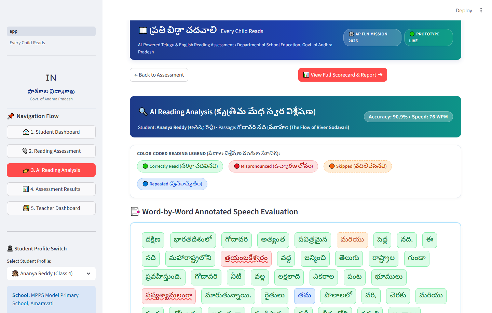
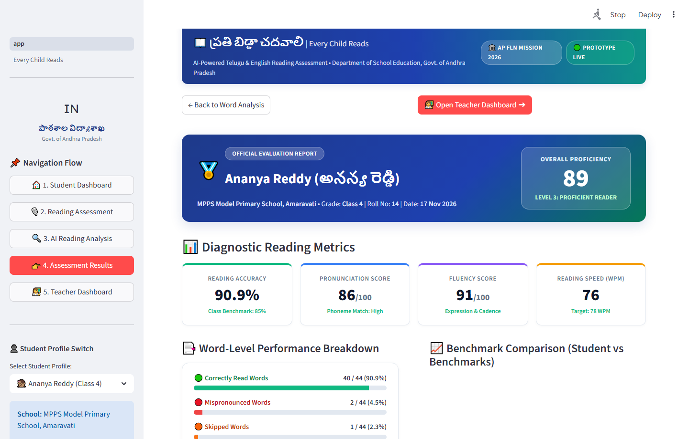
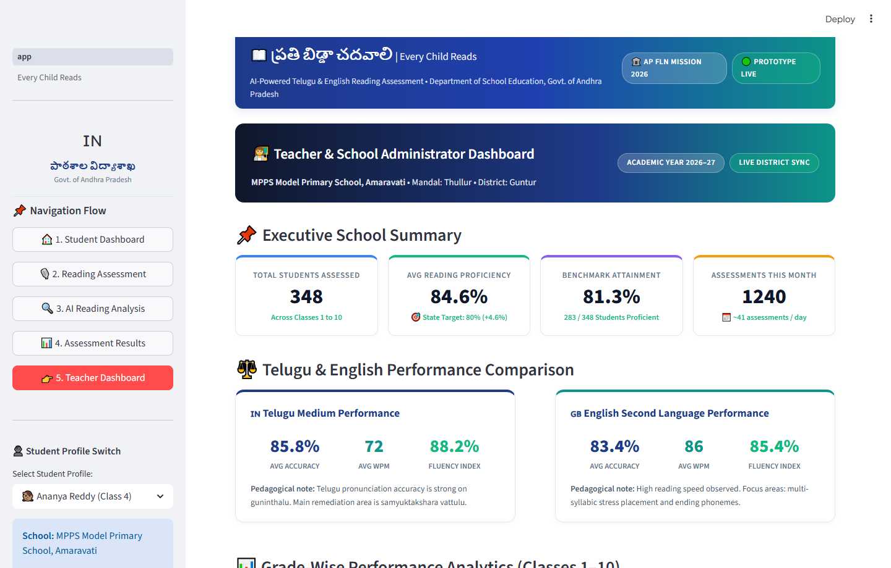

# 📖 AksharaMitra (అక్షరమిత్ర) – AI-Powered Bilingual Reading & Learning Companion
### *Every Child Heard. Every Reader Empowered. • ప్రతి చిన్నారి స్వరం వినిపించాలి • ప్రతి చదువు మెరుగుపడాలి*
**An Education Technology Innovation by SHR Trinity**

---

## 🏛️ Project Overview

**AksharaMitra (అక్షరమిత్ర)** is a student-focused bilingual reading and learning companion developed by **SHR Trinity** to help school students across **Classes 1 through 10** improve their oral reading skills in **Telugu** and **English**.

The platform provides a child-friendly, interactive reading environment, evaluates word-level phonetic accuracy and fluency (`READ → LISTEN → ANALYSE → IDENTIFY → IMPROVE → TRACK`), recommends targeted reading practice, and delivers actionable student and classroom insights to teachers and schools.

---

## ✨ Features & Available Screens

The application includes five interconnected UI screens demonstrating the end-to-end student reading journey and teacher intelligence experience:

### 1. Student Dashboard (`1. Student Dashboard`)
- **Student Profile Hero:** Card featuring the student's avatar, English & Telugu names, student roll number, school name, district, active streak counter (🔥 12 Days), and current proficiency tier.
- **Grade Selector:** Intuitive slider allowing quick selection from **Class 1 to Class 10**.
- **Bilingual Language Switcher:** Interactive toggle between **తెలుగు (Telugu - Mother Tongue)** and **English (Second Language)**.
- **Reading Tier Options:**
  - 🌱 **Beginner (ప్రారంభ స్థాయి):** Classes 1–3 (Sight words & short sentences)
  - 🌿 **Intermediate (మధ్యస్థ స్థాయి):** Classes 4–7 (Compound aksharalu & descriptive passages)
  - 🌳 **Advanced (ఉన్నత స్థాయి):** Classes 8–10 (Technical & academic vocabulary)
- **Live Passage Preview:** Dynamic preview showing passage excerpt, expected duration (~45s), target pace (WPM), and word count.
- **Recent Assessment History:** Historic records and progression milestones.

### 2. Reading Assessment Screen (`2. Reading Assessment`)
- **Child-Friendly Display:** Large, high-contrast, readable text (24px) with generous line-spacing (`2.1`) using high-quality Telugu Unicode typography (`Noto Sans Telugu`).
- **Interactive Audio Console:**
  - Circular microphone recording button with start/stop toggle.
  - Active capture visualization with an **animated pulsing red circle** and dynamic **sound wave audio frequency bars**.
- **Live Reading Timer & Status:** Real-time timer (`00:42 / 01:00 min`) with status chip (`🔴 Active Capture` / `✅ Voice Sample Ready`).
- **Passage Reading Progress:** Live visual progress bar (e.g. 91% complete).
- **Navigation Controls:** One-click restart, demo audio playback, and a prominent **"Submit Reading for AI Assessment"** action button.

### 3. AI Reading Analysis Screen (`3. AI Reading Analysis`)
- **Color-Coded Phonetic Word Highlights:**
  - 🟢 **Correctly Read Words (Green):** Accurate articulation.
  - 🔴 **Mispronounced Words (Red):** Identified pronunciation deviations (e.g., omitted 'త' ఒత్తు in `పూస్తాయి → పూసాయి`) with wavy red underline.
  - 🟠 **Skipped Words (Orange):** Omitted words or conjunctions with dashed border.
  - 🔵 **Repeated Words (Blue):** Articulation repetitions or stutters during rapid reading.
- **Phonetic Deviation Inspector:** Interactive detail cards explaining each identified error and its pedagogical cause.
- **Side-by-Side Comparison:** **Reference Passage (ఆదర్శ పాఠం)** alongside **Recognized Speech (విద్యార్థి పలికిన తీరు)**.
- **Speech Observations Panel:** Detailed notes on Telugu guninthalu, samyuktaksharalu, and syllable rhythm.

### 4. Assessment Results Screen (`4. Assessment Results`)
- **AksharaMitra Evaluation Report Header:** Student ID, school, and overall score (**89 / 100 — Level 3: Proficient Reader**).
- **4 Core Diagnostic Metrics:**
  - **Reading Accuracy:** 90.9%
  - **Pronunciation Score:** 86 / 100
  - **Fluency Score:** 91 / 100
  - **Reading Speed:** 76 Words Per Minute (Benchmark: 78 WPM)
- **Word Breakdown Diagnostics:** Visual progress bars for Correct, Mispronounced, Skipped, and Repeated words.
- **Benchmark Comparison Chart:** Multi-metric bar chart comparing Student Score vs. State Benchmark vs. Class Average.
- **Personalized Improvement Plan:** Targeted daily akshara drills, syllable segmentation exercises, and next passage recommendation.

### 5. Teacher Dashboard (`5. Teacher Dashboard`)
- **Executive School KPIs:** Total Students Assessed (348), Average Reading Proficiency (84.6%), Benchmark Attainment (81.3%), and Monthly Assessments (1,240).
- **Telugu vs. English Comparison:** Side-by-side performance cards comparing accuracy, average WPM, and fluency index.
- **Grade-Wise Analytics (Classes 1–10):** Comparative performance line graph and comprehensive data table.
- **Common Reading Difficulties Analysis:** Breakdown of 5 major error categories (Telugu Vattulu, Mahapranalu, Plural suffixes, English polysyllabic stress, Connector skipping) with specific classroom intervention guidelines.
- **Filterable Student Registry:** Filter by Grade, Language, and Proficiency Status with full tabular registry.
- **Individual Student Progress Tracker:** 6-session longitudinal performance trend graph.

---

## 🖼️ UI Screen Previews

| Screen 1: Student Dashboard | Screen 2: Reading Assessment |
|---|---|
|  |  |

| Screen 3: AI Reading Analysis | Screen 4: Assessment Results |
|---|---|
|  |  |

| Screen 5: Teacher Dashboard |
|---|
|  |

---

## 🛠️ Technology Stack

- **Frontend Framework:** [Streamlit](https://streamlit.io/) (v1.30.0+)
- **Programming Language:** Python 3.10+ / 3.11+
- **Data & Analytics:** Pandas
- **Typography & Styling:**
  - Google Fonts: `Plus Jakarta Sans` & `Noto Sans Telugu`
  - SHR Trinity & AksharaMitra Brand Palette (Deep Navy `#1e3a8a`, Cobalt Blue `#1e40af`, Learning Teal `#0d9488`, Emerald `#10b981`)
  - Pure CSS keyframe animations (Pulsing mic, audio sound wave bars)
- **Dataset & Content Engine:** Custom Python module (`telugu_reading_data.py`) with authentic Telugu Unicode passages and student records.

---

## 📦 Directory Structure

```text
AksharaMitra/
├── app.py                      # Primary Streamlit application entry point
├── telugu_reading_app.py       # Core AksharaMitra UI orchestrator containing all 5 screens & CSS
├── telugu_reading_data.py      # Bilingual passage catalog & student analytics dataset
├── requirements.txt            # Python dependencies
├── run_reading_app.bat         # 1-click Windows batch launcher for AksharaMitra
├── README.md                   # Complete documentation & project guide
├── pages/
│   └── AksharaMitra.py         # Multi-page Streamlit route for AksharaMitra
└── screenshots/                # High-resolution screenshots of all 5 screens
    ├── 01_student_dashboard.png
    ├── 02_reading_assessment.png
    ├── 03_reading_analysis.png
    ├── 04_assessment_results.png
    └── 05_teacher_dashboard.png
```

---

## 🚀 Running AksharaMitra Locally

### Method A: One-Click Launcher (Windows)
Double-click `run_reading_app.bat` in the project root directory.

### Method B: Terminal Command
Run the application using Streamlit:
```bash
streamlit run pages/AksharaMitra.py
```
or launch the full multi-page suite:
```bash
streamlit run app.py
```

Once launched, open your browser at:
```text
Local URL: http://localhost:8501/AksharaMitra
```
